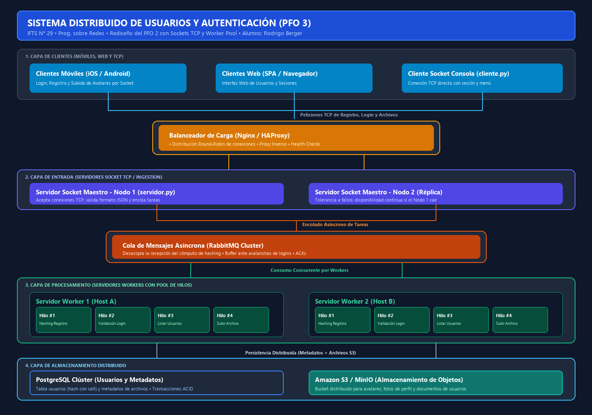

# PFO 3: Rediseño como Sistema Distribuido (Cliente-Servidor)

**Institución:** IFTS N.° 29  
**Materia:** Programación sobre redes - 3.° D  
**Alumno:** Rodrigo Berger  
**Tecnologías:** Python 3, Sockets TCP/IP (`socket`), Multihilo (`threading`), Colas Sincronizadas (`queue.Queue`), Criptografía y Hashing (`werkzeug.security`), Serialización (`json`), SQLite.

---

## 📌 Descripción del Proyecto

El objetivo de este trabajo práctico es **transformar el Sistema de Gestión y Autenticación de Usuarios (desarrollado en el PFO 2) en una Arquitectura Distribuida** utilizando sockets TCP y un **Pool de Workers** en Python.

### ¿Cómo evoluciona el PFO 2 al PFO 3?
- **En el PFO 2:** El sistema era una API REST monolítica con Flask y una base de datos SQLite local donde el servidor HTTP atendía y procesaba todo directamente.
- **En el PFO 3:** Rediseñamos el sistema dividiendo responsabilidades:
  1. El servidor escucha conexiones TCP por **sockets directos**.
  2. Al recibir una petición (registro, login, listado o subida de archivos), **no bloquea la conexión** calculando él mismo: encola la tarea en una cola sincronizada (`queue.Queue`).
  3. Un **Pool de Workers concurrentes** (`Worker-1`, `Worker-2`, `Worker-3`) toma las tareas, ejecuta el procesamiento intensivo de hashing y persistencia, y devuelve el resultado a través del socket.

---

## 🗺️ Diagrama del Sistema Distribuido

Cumpliendo con la consigna, se diseñó el diagrama que modela la arquitectura distribuida completa:



### Integración de Componentes con el Sistema de Usuarios:

1. **Clientes (móviles y web):**  
   Aplicaciones que envían credenciales y consumen servicios (app móvil nativa, navegador web o el cliente de consola TCP `cliente.py`).
2. **Balanceador de Carga (Nginx / HAProxy):**  
   Punto de entrada único que distribuye las conexiones TCP entrantes entre los servidores sockets maestros usando algoritmos como *Round-Robin*, balanceando la carga y ofreciendo *Health Checks*.
3. **Cola de Mensajes (RabbitMQ):**  
   Actúa como buffer persistente para desacoplar la recepción de peticiones del procesamiento de hashing y validación, amortiguando picos de tráfico en momentos de alta concurrencia de logins o registros.
4. **Servidores Workers (con Pool de Hilos):**  
   Clúster de servidores con hilos dedicados que consumen las tareas de la cola y ejecutan las operaciones pesadas:
   - **Registro:** Computa el hash criptográfico con salt (PBKDF2/scrypt).
   - **Login:** Compara contraseñas contra el hash en base de datos.
   - **Subida de Archivos:** Procesa y distribuye archivos binarios y avatares.
5. **Almacenamiento Distribuido (PostgreSQL y S3):**  
   - **PostgreSQL:** Base de datos relacional distribuida para metadatos de usuarios y transacciones (garantía ACID), reemplazando el SQLite local.
   - **Amazon S3 / MinIO:** Almacenamiento de objetos no estructurados para fotos de perfil, avatares y archivos adjuntos.

---

## 🚀 Guía de Ejecución

### 1. Iniciar el Servidor Distribuido
Abre una terminal y ejecuta:
```bash
python servidor.py
```

*Salida esperada:*
```text
=================================================================
   SERVIDOR DISTRIBUIDO DE USUARIOS Y AUTENTICACIÓN (PFO 3)
   Rediseño del PFO 2 con Sockets TCP y Worker Pool
   IFTS N.° 29 | Prog. sobre redes - 3.° D | Rodrigo Berger
=================================================================
[DB] Usuarios de prueba creados: 'Rodrigo' y 'Berger' (clave: '1234')
[DB] Base de datos 'usuarios_distribuido.db' inicializada con éxito.
[SISTEMA] Iniciando Worker Pool con 3 hilos...
[WORKER 1] Iniciado y listo para recibir tareas.
[WORKER 2] Iniciado y listo para recibir tareas.
[WORKER 3] Iniciado y listo para recibir tareas.
[SERVIDOR] Escuchando conexiones TCP en localhost:5000...
```

### 2. Iniciar el Cliente
Abre **otra terminal** distinta y ejecuta:
```bash
python cliente.py
```

*Ejemplo de uso:*
```text
============================================================
   CLIENTE TCP DISTRIBUIDO (PFO 3 - IFTS N° 29)
   Alumno: Rodrigo Berger
============================================================
Conectando al servidor en localhost:5000...
[ÉXITO] Conexión establecida con el servidor localhost:5000.

=======================================================
   PANEL DE USUARIOS DISTRIBUIDO - Sin sesión
=======================================================
 1. Registrar nuevo usuario
 2. Iniciar sesión (Login)
 3. Listar usuarios (Requiere sesión iniciada)
 4. Subir archivo / avatar (PostgreSQL + S3)
 5. Salir (o escribe 'éxito')
=======================================================
Selecciona una opción (1-5) > 2

 [2] INICIO DE SESIÓN
Nombre de usuario: Rodrigo
Contraseña: 1234

[ÉXITO 200] Login exitoso. ¡Bienvenido/a Rodrigo!
 -> Sesión iniciada para: 'Rodrigo'
 -> Verificación de hash ejecutada por: Worker-1 en 165.2 ms.
```

Una vez logueado, puedes listar los usuarios (Opción 3) o simular la subida de un avatar a S3 (Opción 4):
```text
Selecciona una opción (1-5) > 4

 [4] SUBIR ARCHIVO / AVATAR (ALMACENAMIENTO DISTRIBUIDO S3 + BD)
Nombre de archivo: avatar_rodrigo.png
Descripción o contenido: Imagen de perfil en formato PNG.

[ÉXITO 201] Archivo 'avatar_rodrigo.png' subido a S3 y registrado en la BD.
 -> Registro BD: #1 | URI S3: s3://bucket-usuarios-pfo3/Rodrigo/avatar_rodrigo.png
 -> Tamaño: 34 bytes | Procesado por: Worker-3 en 305.1 ms.
```

Para salir del programa:
```text
Selecciona una opción (1-5) > 5

[INFO] Desconectando del servidor...
[INFO] Socket cliente cerrado correctamente.
```

---

## 🧪 Casos de Error y Concurrencia Manejados

- **Acceso No Autorizado (Endpoint protegido):** Si se intenta listar usuarios o subir archivos sin haber iniciado sesión previamente, la petición es rechazada con código `401 Unauthorized`.
- **Usuarios Duplicados:** Si se intenta registrar un usuario ya existente, el worker captura la restricción de unicidad y retorna `409 Conflict`.
- **Concurrencia Segura:** Cada worker abre y cierra su propia conexión a la base de datos, evitando bloqueos entre hilos.
- **Reutilización de Puerto (`SO_REUSEADDR`):** Evita el error de puerto ocupado si se reinicia rápidamente el servidor.
